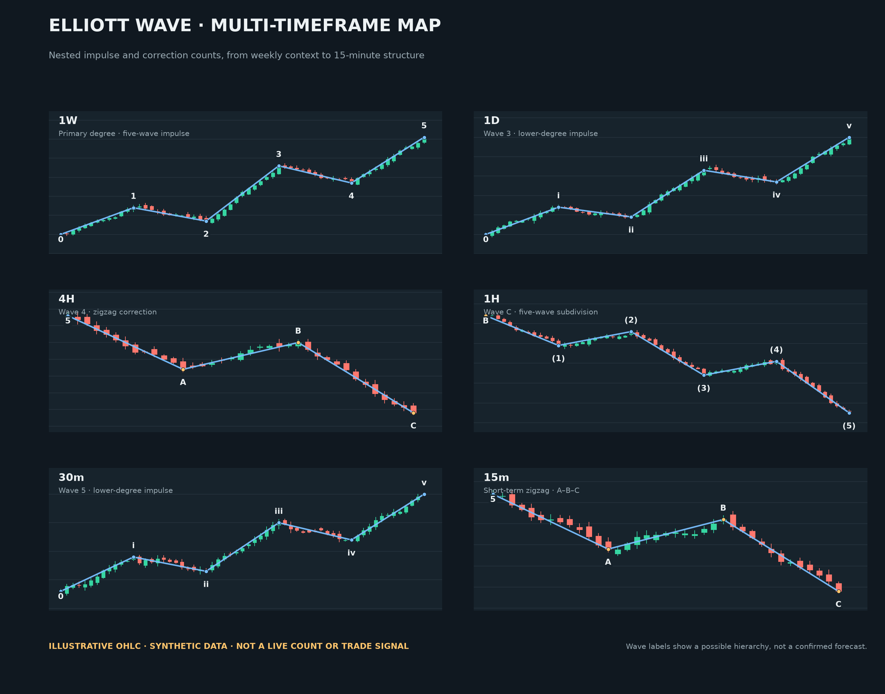
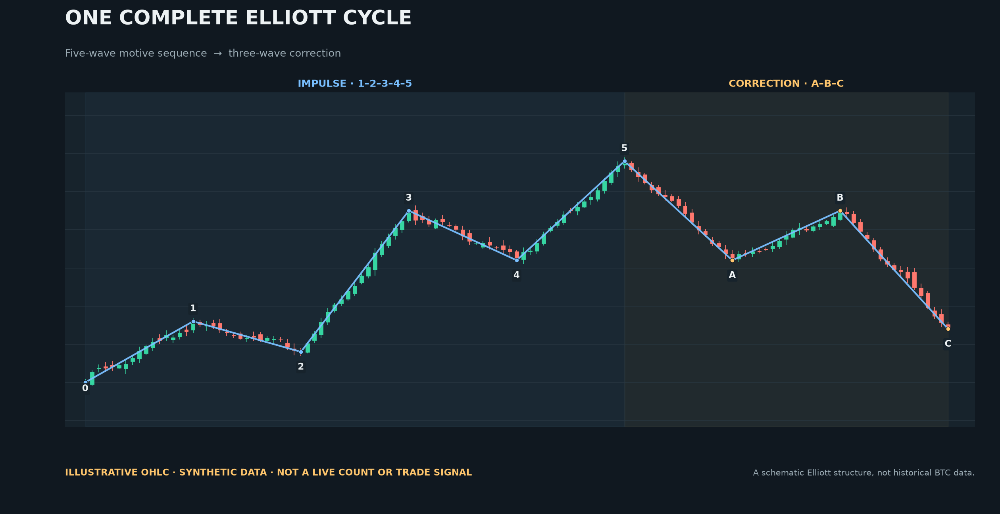

<div align="center">

# Elliott Waves

**Rule-based Elliott Wave analysis and automated BTCUSDT futures trading.**

[Star this repo](https://github.com/alsgyu/ElliotWaves) · [Run locally](#run-locally)

[](https://www.python.org/)
[](https://www.binance.com/)
[](#run-locally)

</div>

<p align="center"></p>
<p align="center"><b>Multi-timeframe map</b><br />Nested 1–5 impulse and A–B–C correction examples from weekly context to 15-minute structure.</p>

<p align="center"></p>
<p align="center"><b>Complete Elliott cycle</b><br />A five-wave motive sequence followed by a three-wave correction. Both images use synthetic candles for illustration, not live BTC data or verified forecasts.</p>

## Core features

1. **Multi-timeframe wave analysis** across 1W, 1D, 4H, 1H, 30m, and 15m, with ranked counts and alternatives.
2. **Automatic Elliott charting** with impulse and correction labels, confirmed pivots, lower-degree structure, Fibonacci references, and invalidation levels.
3. **Automated BTCUSDT trading** with paper-first execution, configurable strategy profiles, and a local decision and trade journal.
4. **Risk controls** for leverage, position sizing, stops, exposure, daily loss limits, and exchange account checks.

## Run locally

Requires Python 3.11+ and internet access for Binance public market data.

```bash
git clone https://github.com/alsgyu/ElliotWaves.git
cd ElliotWaves
./start.sh
```

Open <http://127.0.0.1:8765/>. The app starts in paper mode; press **Start** in the interface to begin simulated trading. No API key is needed for paper mode.

> Elliott counts are interpretations, not guaranteed forecasts. Start in paper mode and verify every live account setting before enabling real orders.
