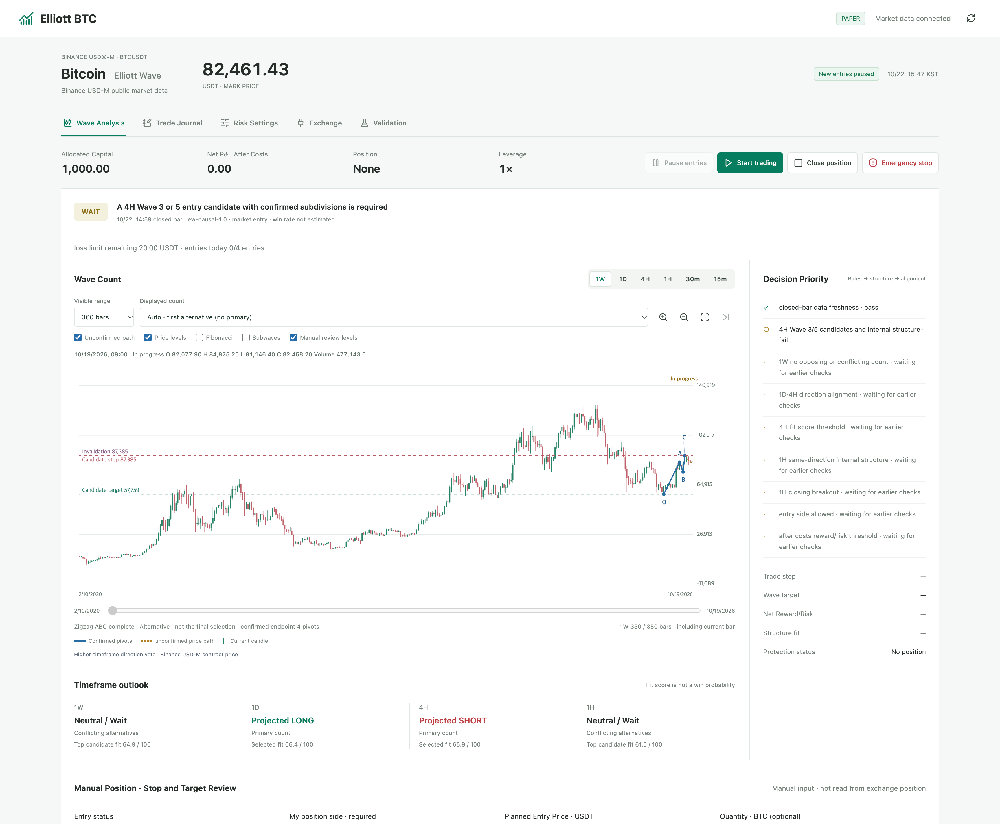
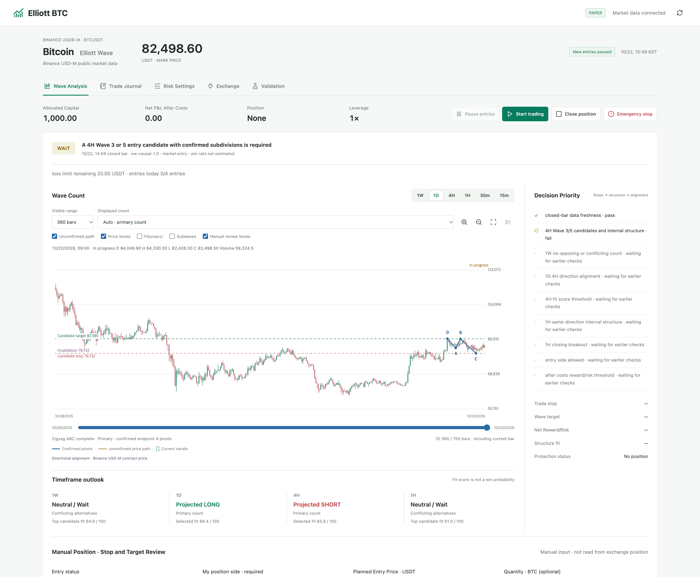
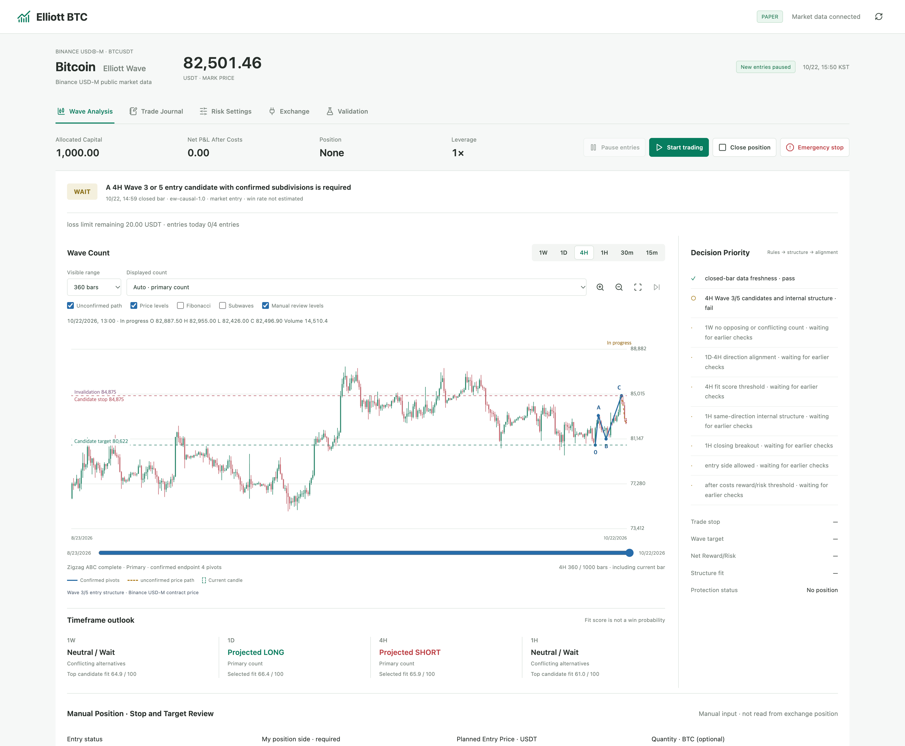
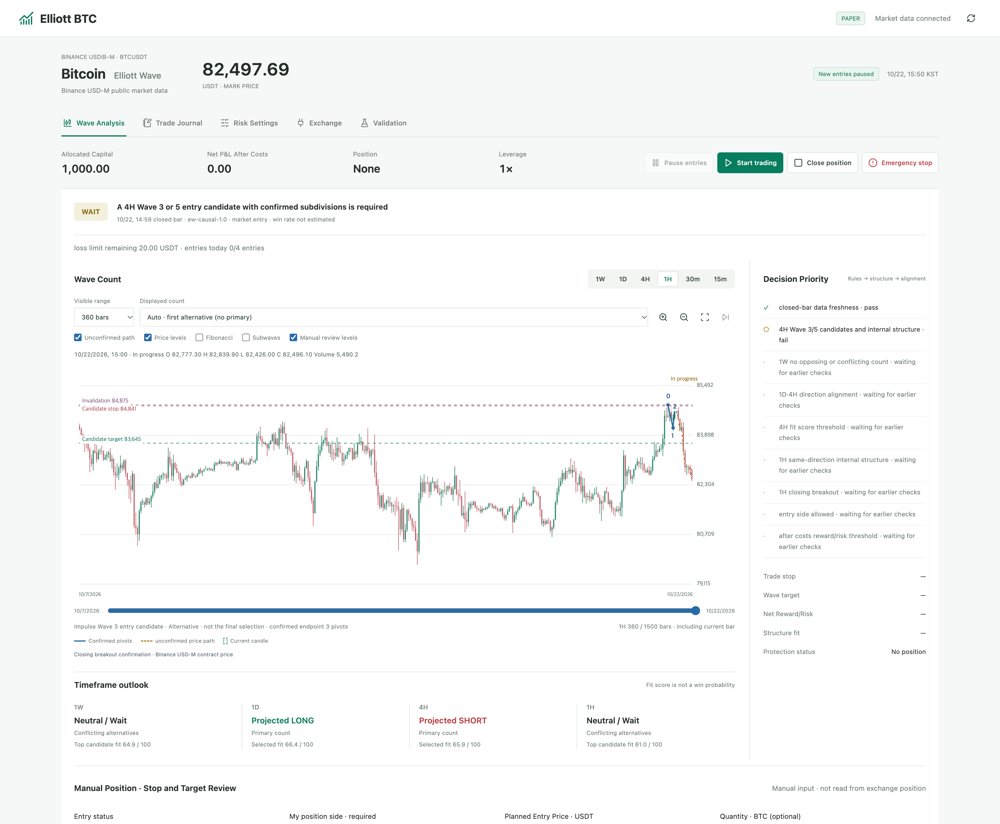

<div align="center">

# Elliott Waves

**Rule-based Elliott Wave analysis and automated BTCUSDT futures trading.**

[Star this repo](https://github.com/alsgyu/elliott-wave-auto-trading) · [Run locally](#run-locally)

[](https://www.python.org/)
[](https://www.binance.com/)
[](#run-locally)

</div>

## Live app analysis

The app analyzes current BTCUSDT candles, draws its own Elliott count on each selected timeframe, and ranks the resulting directional candidates. Each screenshot is captured from this app in paper mode using Binance USDⓈ-M public market data on **October 22, 2026**. Click any image to inspect the full-resolution chart.

**1W · Neutral / Wait**<br />
Top candidate fit: **64.9 / 100** · conflicting alternatives

<p align="center"><a href="docs/images/timeframe-1w.png"></a></p>

**1D · Projected LONG**<br />
Selected fit: **66.4 / 100** · primary count

<p align="center"><a href="docs/images/timeframe-1d.png"></a></p>

**4H · Projected SHORT**<br />
Selected fit: **65.9 / 100** · primary count

<p align="center"><a href="docs/images/timeframe-4h.png"></a></p>

**1H · Neutral / Wait**<br />
Top candidate fit: **61.0 / 100** · conflicting alternatives

<p align="center"><a href="docs/images/timeframe-1h.png"></a></p>

**Fit scores rank rule-based structural matches; they are not probabilities, confidence levels, or win rates.** In this captured market snapshot the overall decision is **WAIT** and new entries are paused. The directional projections are conditional Elliott-wave hypotheses, not trade instructions.

## Core features

1. **Multi-timeframe wave analysis** across 1W, 1D, 4H, 1H, 30m, and 15m, with ranked counts and alternatives.
2. **Automatic Elliott charting** with impulse and correction labels, confirmed pivots, lower-degree structure, Fibonacci references, and invalidation levels.
3. **Automated BTCUSDT trading** with paper-first execution, configurable strategy profiles, and a local decision and trade journal.
4. **Risk controls** for leverage, position sizing, stops, exposure, daily loss limits, and exchange account checks.

## Run locally

Requires Python 3.11+ and internet access for Binance public market data.

```bash
git clone https://github.com/alsgyu/elliott-wave-auto-trading.git
cd elliott-wave-auto-trading
./start.sh
```

Open <http://127.0.0.1:8765/>. The app starts in paper mode; press **Start** in the interface to begin simulated trading. No API key is needed for paper mode.

> Elliott counts are interpretations, not guaranteed forecasts. Start in paper mode and verify every live account setting before enabling real orders.
