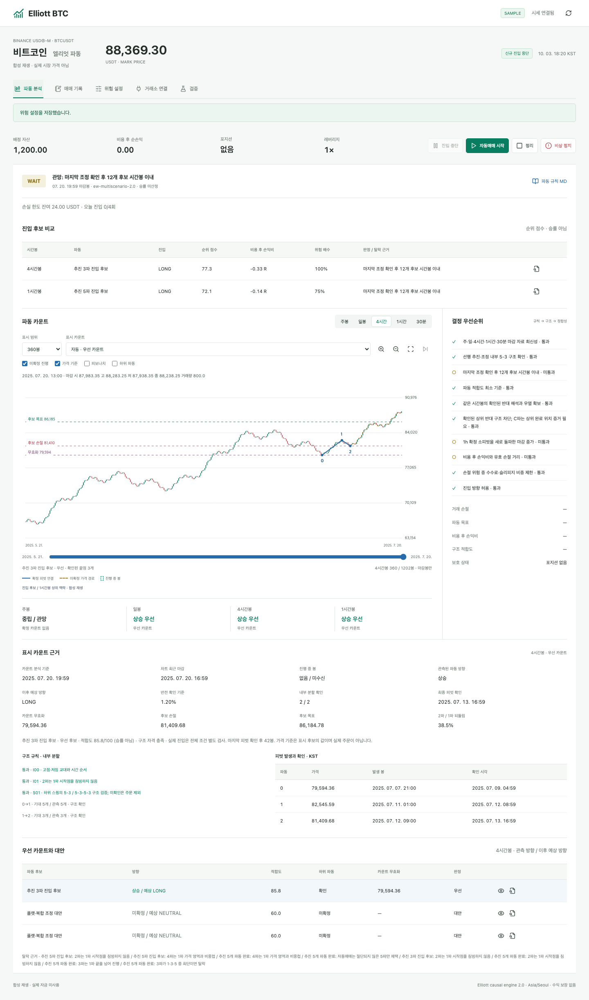
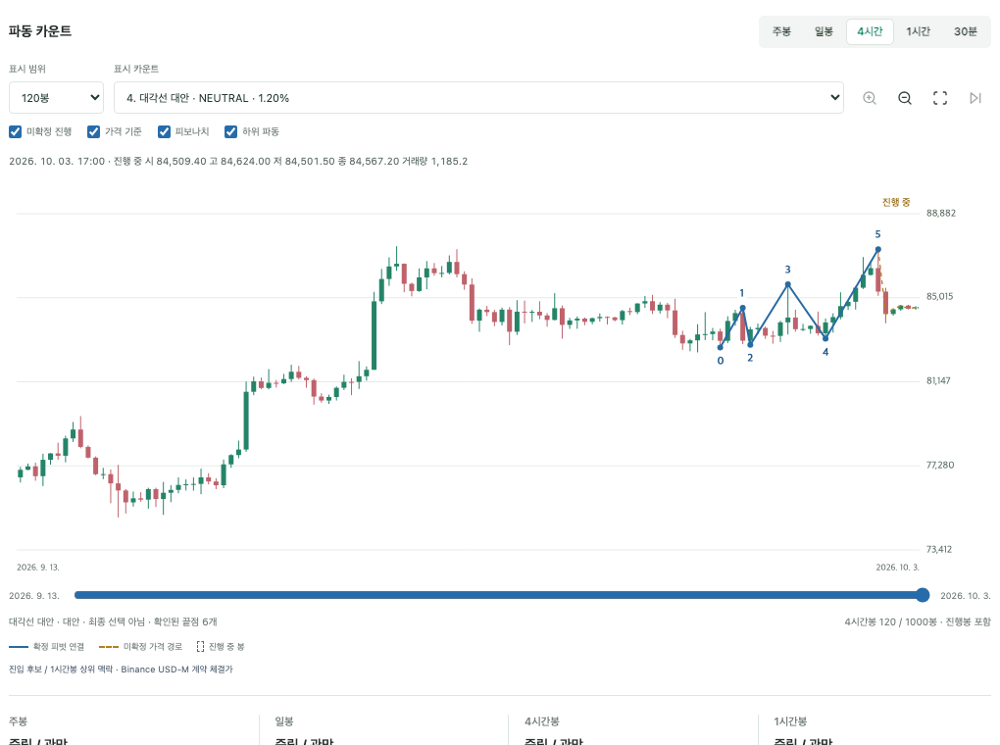
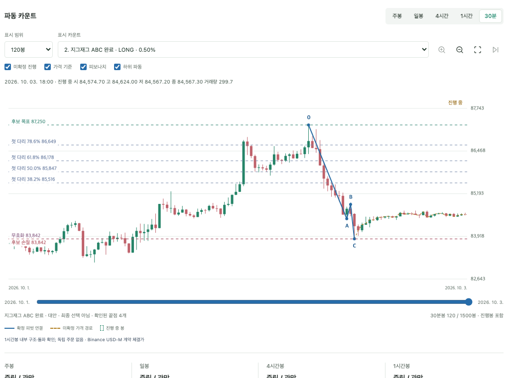
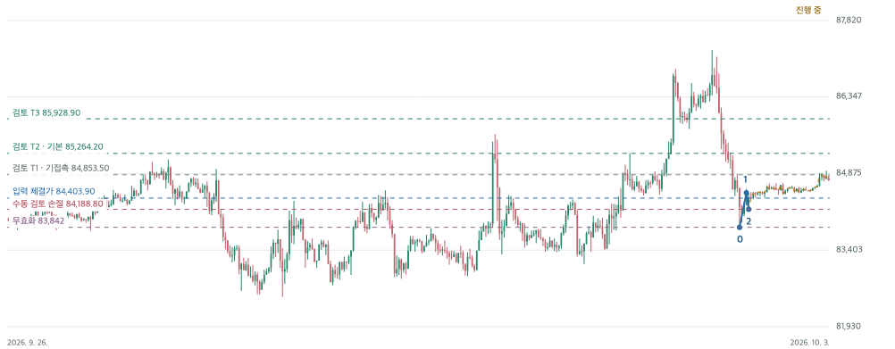
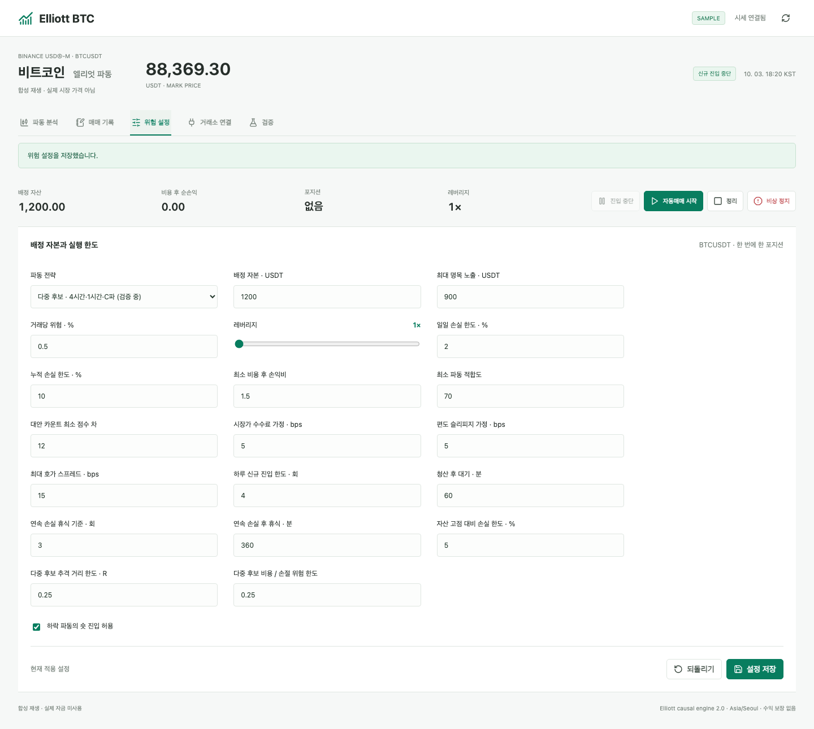

<div align="center">

# Elliott BTC

**BTCUSDT 무기한 선물용 규칙 기반 엘리엇 파동 분석기**
<br />여러 시간봉 차트, 명시적 무효화 가격, 위험 통제 기능을 갖춘 로컬 실행 트레이딩 워크스테이션입니다.

[English](../README.md) · [한국어](README.ko.md)

[](https://www.python.org/)
[](https://www.binance.com/)
[](../README.md#privacy-and-security)
[](https://github.com/alsgyu/Elliot/stargazers)

</div>

<p align="center">
  
</p>
<p align="center"><sub>데스크톱 화면 · 합성 샘플 시세 · 거래소 계정 미연결</sub></p>

> 엘리엇 파동 카운트는 해석이지 확률이 아닙니다. 적합도 점수는 규칙에 맞는 구조의 순위를 나타내며 승률이 아닙니다. 높은 예측 정확도나 수익을 보장한다고 주장하지 않습니다.

## 기능

- BTCUSDT 무기한 선물의 **주봉·일봉·4시간봉·1시간봉·30분봉·15분봉**을 분석합니다. 진입 가능 시간봉은 선택한 전략에 따라 달라지며, 작은 시간봉이라고 더 나은 신호로 간주하지 않습니다.
- 추진파와 지그재그 조정의 엘리엇 파동 후보를 고정 규칙으로 구성합니다. 관측된 파동 방향과 후보의 예상 방향을 따로 기록합니다.
- 확정 피벗, 하위 파동 근거, 대안 카운트, 무효화·후보 손절·목표·피보나치 기준을 차트에 표시합니다.
- 구조, 상위 시간봉 맥락, 종가 돌파, 수수료, 슬리피지, 스프레드, 최소 주문 수량, 계정 위험을 검사한 뒤에만 진입을 고려합니다.
- 결정과 실행 이벤트를 로컬 SQLite에 기록하고 진입·청산·복구 근거를 Markdown 거래 기록으로 남깁니다.
- 기본 실행은 **모의거래**입니다. 서버를 켜는 것만으로 매매가 시작되지 않으며, 화면에서 **자동매매 시작**을 눌러야 합니다.

## 화면

아래 이미지는 실제 프로그램에서 캡처했습니다. 4시간봉·30분봉은 모의거래 화면이고, 수동 검토선과 위험 설정은 로컬 샘플 데이터 화면입니다.

<table>
  <tr>
    <td width="50%"><a href="images/waves-4h-paper.png"></a><br /><sub>4시간봉 · 스윙 구조와 대안 카운트</sub></td>
    <td width="50%"><a href="images/waves-30m-paper.png"></a><br /><sub>30분봉 · ABC 후보와 피보나치 참고선</sub></td>
  </tr>
  <tr>
    <td><br /><sub>수동 검토 · 가정 진입가, 손절, 무효화, 목표 참고선</sub></td>
    <td><br /><sub>위험 설정 · 배정 자본, 레버리지, 손실 한도</sub></td>
  </tr>
</table>

## 시간봉 판단

기본 엄격 프로필은 신호를 제한적으로 선택합니다.

| 시간봉 | 역할 |
| --- | --- |
| 주봉 | 상위 시간봉의 반대 구조가 있으면 진입 거부 |
| 일봉 | 방향 맥락 |
| 4시간봉 | 주요 3파·5파 후보 |
| 1시간봉 | 하위 구조와 종가 돌파 확인 |
| 30분봉 | 일부 프로필에서 맥락 또는 확인용. 기본 설정에서는 단독 신호가 아님 |
| 15분봉 | 선택형 단기 프로필의 내부 확인용. 단독 진입 없음 |

다중 후보·단기 프로필은 더 많은 구조를 비교하지만 수익률을 개선한다고 입증되지는 않았습니다. 충돌은 정해진 우선순위로 판단하며, 카운트가 불명확하거나 미완성이면 `WAIT`가 정상적인 결과일 수 있습니다.

## 탐색 결과와 한계

[`docs/ELLIOTT_RESEARCH_VERIFICATION.md`](ELLIOTT_RESEARCH_VERIFICATION.md)의 30일 탐색 재생에서는 **11건이 청산 완료**되었고 그중 **4건이 이익**이었습니다. 1,000 USDT로 시작해 10일씩 나눈 세 구간에서 완료 거래 순손익 합계는 **+0.2211 USDT**였습니다. 같은 거래의 가정 수수료와 불리한 슬리피지를 두 배로 다시 계산하면 **−4.1335 USDT**였습니다.

개발 중 반복해서 사용한 작은 표본이며, 별도로 보관한 미사용 검증 구간이 아닙니다. 구간 경계에 미청산 포지션 1건이 있었습니다. 이 결과는 지속 가능한 우위, 신뢰할 수 있는 승률, 높은 정확도를 입증하지 않습니다. 적합도 점수도 통계적으로 보정되지 않았습니다.

원본 시세 스냅샷과 구간별 재생 파일은 로컬 연구 산출물이라 이 저장소에는 포함하지 않았습니다. 따라서 위 수치는 문서화된 요약이며, 저장소를 새로 받은 상태에서 재현되는 결과는 아닙니다.

## 로컬 실행

필요 환경: macOS 또는 Linux, Python 3.11 이상. 첫 실행의 인증서 패키지 설치와 Binance 공개 시세 수신에는 인터넷 연결이 필요합니다.

```bash
git clone https://github.com/alsgyu/Elliot.git
cd Elliot
./start.sh
```

브라우저에서 <http://127.0.0.1:8765/>를 여세요. 실행 스크립트는 로컬 가상환경을 만들고 필요할 때 고정된 인증서 패키지를 설치한 다음 모의거래 모드로 시작합니다. 모의 시세 감시와 가상 체결을 시작하려면 화면의 **자동매매 시작**을 누르세요. 서버는 터미널에서 `Ctrl+C`로 종료합니다.

거래소 시세 없이 분리된 합성 샘플을 실행하려면:

```bash
./start.sh --sample --port 8766 --data data/elliott-sample
```

샘플 모드는 화면에 표시되며 데모·실거래로 전환할 수 없습니다. 실행 모드마다 로컬 데이터가 분리됩니다.

## 거래소 연결

공개 시세 조회에는 API 키가 필요하지 않습니다. Binance 데모·실거래에는 USDⓈ-M 선물 계정 활성화와 별도 API 키가 필요합니다. 실거래 키에는 **Reading + Futures**만 허용하고, 실행 PC의 공인 IP를 허용 목록에 등록하며, 출금·이체 권한은 끄세요. 지원되는 계정 설정은 USDⓈ-M·단일 담보·One-way·격리 증거금입니다.

실거래 주문 경로는 구현되어 있지만 문서에 있는 재생·화면 검증이 실제 거래소 체결이나 수익성을 입증하지는 않습니다. 계정 자격과 최신 거래소 API 규칙을 직접 확인하세요. API Secret을 이슈·README·소스 코드에 붙여 넣지 마세요.

## 위험과 운용 한계

- 레버리지는 1~10배에서 설정할 수 있고 기본은 1배입니다. 수량은 설정한 위험·명목 노출 한도, 거래소 주문 필터, 계정 상태로 제한됩니다.
- 일일·누적 손실 한도, 일일 진입 수, 청산 후 대기, 연속 손실 휴식, 중복 진입 방지를 적용합니다.
- 신호를 확인한 뒤 시장가로 진입합니다. 지원되는 실계좌 포지션에는 거래소 보호 손절·익절을 등록합니다. 손절은 보장된 체결 가격이나 최대 손실 보장선이 아닙니다.
- 차트의 후보 손절과 카운트 무효화는 서로 다른 가격입니다. 수동 검토선은 참고 추정치이며 주문을 만들거나 관리하지 않습니다.
- 컴퓨터가 잠자기 상태가 되거나 앱이 종료되거나 인터넷이 끊기면 로컬 감시가 중단됩니다. 실계좌 포지션의 거래소 보호 주문이 남아 있을 수 있으므로 거래소 화면도 직접 확인하세요.

## 개인정보와 보안

서버는 기본적으로 `127.0.0.1`에만 연결합니다. 자격 증명과 거래 기록은 선택한 로컬 데이터 폴더에 저장합니다. 자격 증명 파일은 소유자 전용 권한으로 제한하지만 프로그램이 암호화하지는 않습니다. 운영체제 계정과 디스크를 보호하세요. 런타임 DB·로그·가상환경·생성 산출물은 `.gitignore`에서 제외합니다.

## 주요 파일

| 경로 | 역할 |
| --- | --- |
| `elliottbot/waves.py` | 피벗과 파동 후보 구성 |
| `elliottbot/strategy.py` | 시간봉 우선순위·후보 순위·진입 조건 |
| `elliottbot/risk.py` | 포지션 수량과 위험 한도 |
| `elliottbot/execution.py` | 주문 수량·보호 주문·거래소 실행 |
| `elliottbot/journal.py` | 로컬 이벤트 원장과 거래 기록 |
| `elliottbot/chart.py` | 차트 데이터와 파동 주석 |
| `elliottbot/static/` | 로컬 웹 인터페이스 |
| `docs/ELLIOTT_RULES.md` | 세부 규칙과 가격 계산 기준 |
| `docs/ELLIOTT_VERIFICATION.md` | 실행·구현 검증 기록 |

최신 검증 문서에는 2026-10-05 기준 단위·회귀·HTTP 테스트 194개 통과가 기록되어 있습니다. 인증된 거래소 종단 간 체결이나 수익성 인증은 포함하지 않습니다.

## 기여

재현할 수 있는 버그 제보와 범위를 좁힌 PR을 환영합니다. 소프트웨어 결함과 엘리엇 카운트 해석의 이견을 구분해 주세요. API 키, 계정 식별 정보, 비공개 거래 기록은 올리지 마세요.

프로젝트가 유용했다면 GitHub Star가 다른 사용자에게 프로젝트를 알리는 데 도움이 됩니다. Star 수는 전략이 작동한다는 근거가 아닙니다.

## 라이선스

현재 저장소에는 `LICENSE` 파일이 없습니다.
